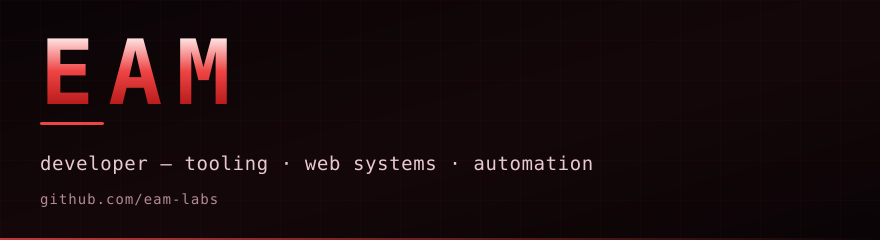
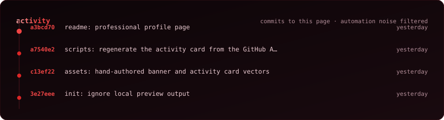

<!-- eam · developer profile
     All graphics live in this repo: hero.svg (wide), hero-mobile.svg (narrow
     screens) and timeline.svg (regenerated nightly by scripts/render.mjs).
     No third-party widgets, no badges, no borrowed statistics. -->

<div align="center">

<picture>
  <source media="(max-width: 599px)" srcset="https://raw.githubusercontent.com/eam-labs/eam-labs/8409265/assets/hero-mobile.svg" />
  
</picture>

<br />

<sub>
<a href="#-about">about</a> ·
<a href="#-work">work</a> ·
<a href="#-tools">tools</a> ·
<a href="#-activity">activity</a> ·
<a href="#-contact">contact</a>
</sub>

</div>

## `> about`

I build developer tooling, web systems and automation — usually the unglamorous kind that
takes a repeated manual task and makes it disappear.

This page is the working sample: a scheduled pipeline fetches data from the GitHub API,
renders it into responsive vector cards, commits them, and republishes the page without
anyone touching it. The code is small, readable, and linked below.

---

## `> work`

Everything public today is this repository — one small, complete system rather than a list
of half-finished experiments.

| piece | what it does | where |
|---|---|---|
| Renderer | calls the GitHub REST API, drops automation noise, draws the activity card as SVG | [`scripts/render.mjs`](scripts/render.mjs) |
| Scheduled workflow | runs the renderer nightly, commits fresh assets, re-pins image URLs so no stale image survives caching | [`render.yml`](.github/workflows/render.yml) |
| Identity banner | hand-authored vector with SMIL animation, plus a narrow variant picked by a media query | [`assets/hero.svg`](assets/hero.svg) · [`hero-mobile.svg`](assets/hero-mobile.svg) |

Nothing here is borrowed: no employer, client or third-party project is claimed as mine.
Anything not yet public simply is not listed — when it is public, it gets linked, not
described.

---

## `> tools`

Only what this repository demonstrates, with a link to prove each line.

| tool | how it is used here | evidence |
|---|---|---|
| Node.js | dependency-free fetching, parsing and SVG generation | [`scripts/render.mjs`](scripts/render.mjs) |
| GitHub REST API | commit feed for the activity card | [`scripts/render.mjs`](scripts/render.mjs) |
| GitHub Actions | scheduled regeneration, commit and push | [`render.yml`](.github/workflows/render.yml) |
| SVG · SMIL | hand-authored banner and data card, animated and resolution-independent | [`assets/hero.svg`](assets/hero.svg) |
| Markdown · GitHub HTML | semantic layout with tables and collapsible sections | [`README.md`](README.md) |
| Git | keeping generated assets out of the way, with pinned URLs as a cache strategy | repository history |

---

## `> activity`

<div align="center">

<picture>
  <source media="(max-width: 599px)" srcset="https://raw.githubusercontent.com/eam-labs/eam-labs/8409265/assets/timeline-mobile.svg" />
  
</picture>

</div>

Real commits to this page only; the automation's own chore commits are filtered out. A
wall of green squares would look better and mean less, so the card shows the trail that
actually exists.

---

## `> contact`

| | |
|---|---|
| GitHub | [@eam-labs](https://github.com/eam-labs) |
| Best route | [open an issue](https://github.com/eam-labs/eam-labs/issues) — no personal email is published |
| Open to | developer-tooling work, collaborations, and code review |

---

<details>
<summary><b>🩸 the personality bit</b></summary>

<br />

Dark mode, red accents, hand-written vectors, and a persistent fondness for cats.
No template, no badge soup, no borrowed statistics.

```
 /\_/\
( o.o )  mew.
 > ^ <
```

</details>
